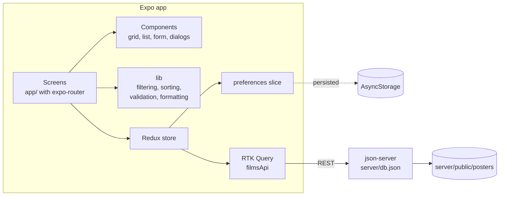

# CineList

**English** · [Türkçe](README.tr.md)

A personal film archive for phones and the web: add, edit and remove films, browse them as posters or a list, search, filter by genre and sort.

[](https://github.com/Beratoguzhan620/cinelist/actions/workflows/ci.yml)


<p align="center"></p>

## Try it

```bash
pnpm install
pnpm dev:web
```

This starts json-server on port 5174 and the Expo web app. To open it on a phone, run `pnpm dev` and scan the QR code with Expo Go (see [Running on a device](#running-on-a-device)).

The archive starts with 20 films. `pnpm db:reset` brings the data back to that seed at any time.

## Features

- **Poster grid or list:** switch with one tap. The grid uses two to six columns depending on screen width.
- **Search:** by title, ignoring case and accents with Turkish rules ("KIŞ" finds "Kış Uykusu", "amelie" finds "Amélie").
- **Genre filter and sorting:** genre chips built from the films in the archive. Four sort orders: last added, rating, year and title (Turkish alphabet).
- **Remembered preferences:** view and sort order survive a restart (redux-persist with AsyncStorage). Film data always comes from the API.
- **Film detail:** poster, rating, year, duration, genre and summary.
- **Add and edit:**
  - Each field is validated with the message right under it; the message clears as soon as the field is fixed.
  - Ratings accept a comma or a dot (`8,5` or `8.5`).
  - The poster URL is optional, with a live preview; films without one get a neutral placeholder.
- **Delete:** asks for confirmation in a dialog.
- **Optimistic updates:** edits and deletes show instantly. If the server refuses, the change is rolled back and a message explains it.
- **Every state covered:** skeleton while loading, a clear error with a retry button when json-server is unreachable, an empty archive, and no results for a search.
- **Pull to refresh** on phones, a refresh button on the web.

## Screenshots

| Poster grid | List view | Detail | Form |
|---|---|---|---|
|  |  |  |  |


| Validation | Delete confirmation |
|---|---|
|  |  |

## Tech stack

- Expo SDK 58, React Native 0.88, expo-router (file-based routes), TypeScript in strict mode
- Redux Toolkit, RTK Query and redux-persist
- NativeWind (Tailwind) with the colours, type scale and radii from [docs/DESIGN.md](docs/DESIGN.md); IBM Plex Sans and Mono; lucide icons
- json-server as the REST backend, started together with Expo by concurrently
- Vitest for unit tests, Playwright for an end-to-end flow on the web build
- GitHub Actions: type check, lint, unit tests, web build, API smoke test and the end-to-end flow

## Architecture



- **Cache shape:** the list and each detail are cached by RTK Query. Mutations patch those caches directly instead of refetching, and undo the patch when the request fails.
- **Seed vs working data:** `server/db.seed.json` is committed; `server/db.json` is the copy json-server writes to, and is ignored by git.
- **Posters:** the seed posters are typographic images generated by `scripts/make-posters.py` and served by json-server. No film studio artwork is included.

## Running on a device

1. Copy `.env.example` to `.env`.
2. Set `EXPO_PUBLIC_API_URL`:
   - Android emulator: `http://10.0.2.2:5174`
   - Physical phone: your computer's LAN address, e.g. `http://192.168.1.20:5174`
3. Run `pnpm dev` and open the project in Expo Go.

json-server listens on all interfaces so a phone on the same network can reach it.

## Scripts

| Command | What it does |
|---|---|
| `pnpm dev` / `pnpm dev:web` | json-server and Expo together (native / web) |
| `pnpm api` | json-server only |
| `pnpm db:reset` | Restore the 20 seed films |
| `pnpm typecheck` | `tsc --noEmit` |
| `pnpm lint` | ESLint (expo config) |
| `pnpm test` | Unit tests |
| `pnpm build:web` | Static web build in `dist/` |
| `pnpm serve:web` | Serve `dist/` on port 8090 |
| `pnpm test:e2e` | End-to-end flow against the served web build |

## Tests

```bash
pnpm test
```

39 unit tests cover:

- **Filtering and sorting:** Turkish case rules, accents, combined search and genre, tie-breaking, the Turkish alphabet.
- **Validation:** every field's limits (year, duration, rating with comma or dot, description length, optional poster URL) and a round trip from a film to the form and back.
- **Optimistic updates:** the list changes before the server answers, and rolls back when a delete or an edit fails.

The end-to-end flow (`pnpm build:web`, `pnpm api`, `pnpm serve:web`, then `pnpm test:e2e`) runs in a real browser. It searches, filters, sorts and switches views, then adds, edits and deletes a film. It also checks the form errors and the not-found page, and fails if a page scrolls sideways on desktop or phone.

## Roadmap and known gaps

- Live web demo.
- Watch list and "watched on" dates.
- Dark theme (the tokens are already in the design document).

## Background

This project started as a bootcamp project and was later rebuilt from the ground up. The assignment was a film CRUD app on Redux Toolkit, RTK Query and json-server; what changed:

- **Stack:** TypeScript in strict mode, expo-router and NativeWind on a current Expo SDK, managed with pnpm.
- **Design:** a small design system shared with my other projects, original typographic posters, an app icon and splash screen.
- **Behaviour:** optimistic updates with rollback, field-level validation, search that understands Turkish, persisted preferences, and loading, error and empty states.
- **Quality:** unit tests, an end-to-end browser flow and CI on every pull request.

## License

[MIT](LICENSE) · Berat Oğuzhan Turğut · [GitHub](https://github.com/Beratoguzhan620)
