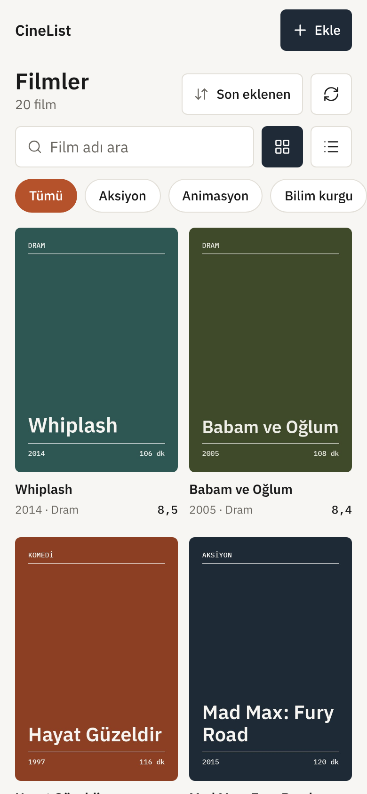
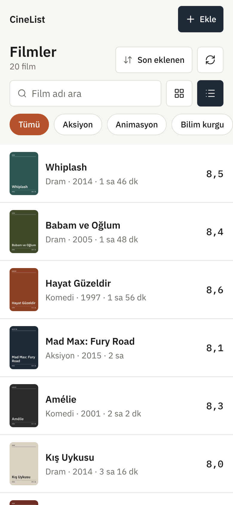
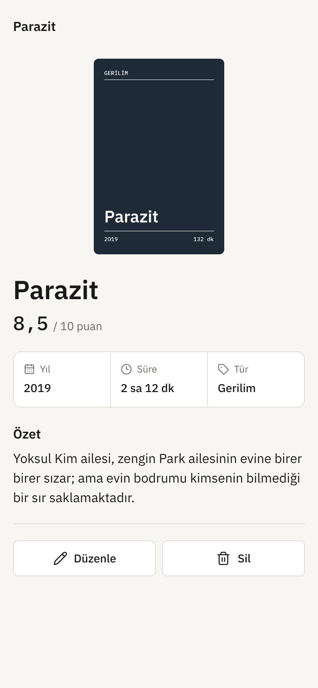
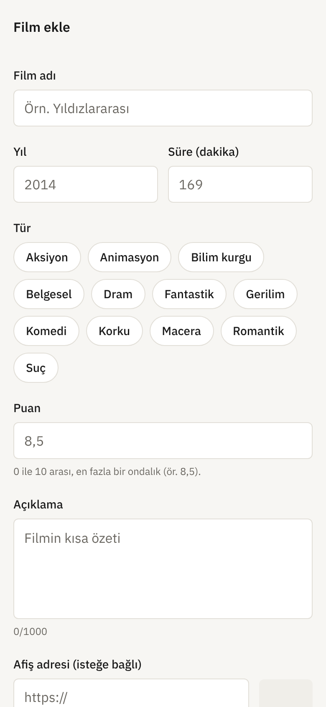
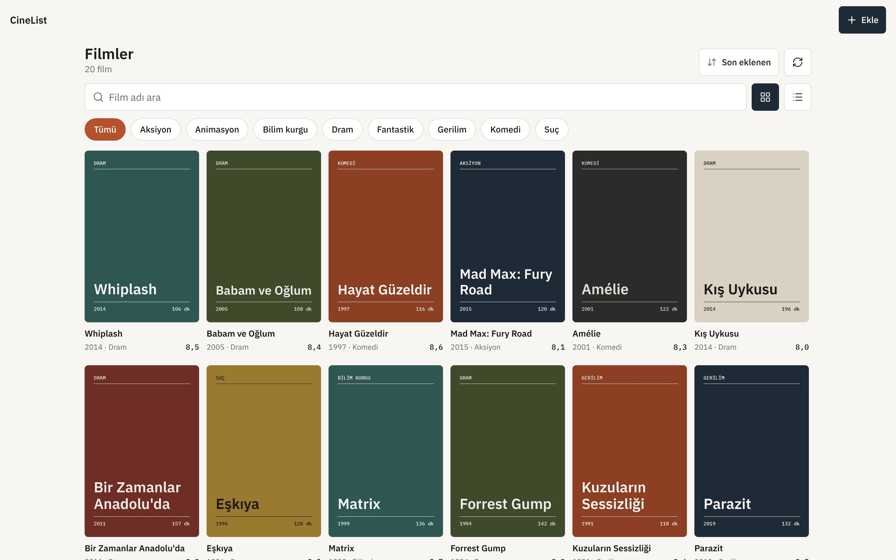
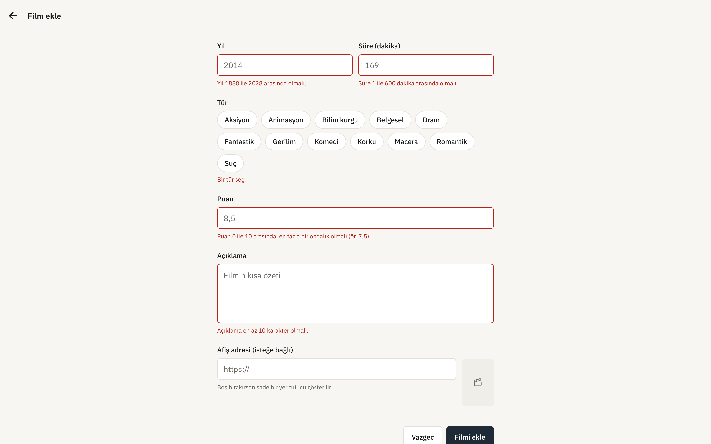
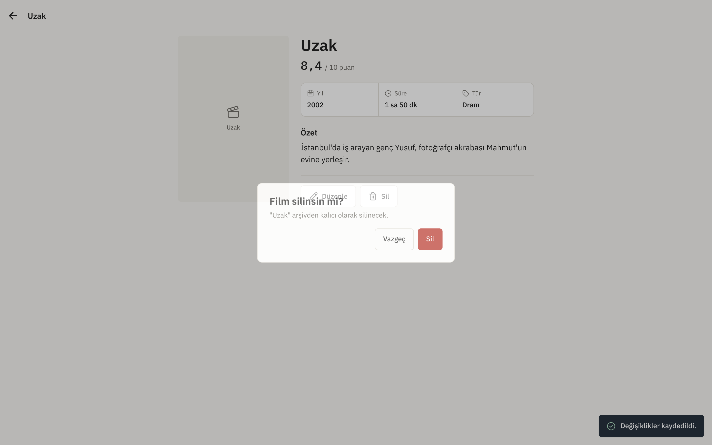
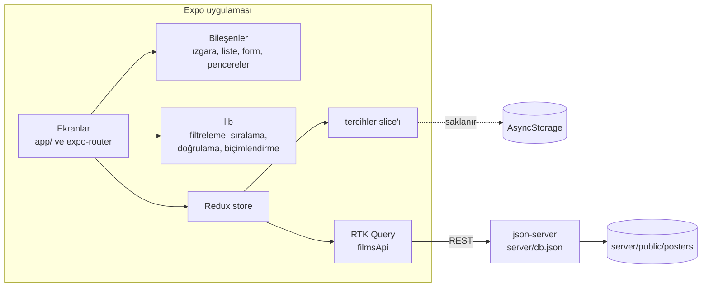

# CineList

[English](README.md) · **Türkçe**

Telefon ve web için kişisel film arşivi: film ekle, düzenle, sil; afiş ya da liste olarak gez, ara, türe göre filtrele ve sırala.

[](https://github.com/Beratoguzhan620/cinelist/actions/workflows/ci.yml)


<p align="center"></p>

## Dene

**Canlı demo:** [beratoguzhan620.github.io/cinelist](https://beratoguzhan620.github.io/cinelist/) (demo modunda web sürümü: filmler tarayıcında tutulur, sunucu gerekmez; yerelde de bu şekilde açmak için `EXPO_PUBLIC_DEMO=1` kullan)

```bash
pnpm install
pnpm dev:web
```

Bu komut json-server'ı 5174 portunda ve Expo web uygulamasını birlikte başlatır. Telefonda açmak için `pnpm dev` çalıştırıp QR kodu Expo Go ile okut ([Telefonda çalıştırma](#telefonda-çalıştırma) bölümüne bak).

Arşiv 20 filmle başlar. `pnpm db:reset` veriyi istediğin an bu başlangıç hâline döndürür.

## Özellikler

- **Afiş ızgarası ya da liste:** tek dokunuşla geçiş. Izgara, ekran genişliğine göre iki ile altı sütun arasında değişir.
- **Arama:** film adına göre; büyük/küçük harf ve aksanlar Türkçe kurallarla yok sayılır ("KIŞ" yazınca "Kış Uykusu", "amelie" yazınca "Amélie" bulunur).
- **Tür filtresi ve sıralama:** tür etiketleri arşivdeki filmlerden oluşur. Dört sıralama var: son eklenen, puan, yıl ve ad (Türk alfabesiyle).
- **Hatırlanan tercihler:** görünüm ve sıralama, uygulama kapanıp açılınca da korunur (redux-persist ve AsyncStorage). Film verisi her zaman API'den gelir.
- **Film detayı:** afiş, puan, yıl, süre, tür ve özet.
- **Ekleme ve düzenleme:**
  - Her alan ayrı doğrulanır ve hata mesajı alanın hemen altında çıkar. Alan düzeltilince mesaj hemen kaybolur.
  - Puanda virgül de nokta da kabul edilir (`8,5` ya da `8.5`).
  - Afiş adresi isteğe bağlıdır ve anlık önizlemesi görünür. Afişi olmayan filmlere sade bir yer tutucu gösterilir.
- **Silme:** önce bir onay penceresi açılır.
- **İyimser güncelleme:** düzenleme ve silme ekrana anında yansır. Sunucu isteği reddederse değişiklik geri alınır ve bir mesajla açıklanır.
- **Her durum düşünüldü:** yüklenirken iskelet görünüm; json-server'a ulaşılamazsa açık bir hata ve "Tekrar dene" düğmesi; boş arşiv; sonuç bulunamayan arama.
- Telefonda **aşağı çekip yenileme**, web'de yenile düğmesi.

## Ekran görüntüleri

| Afiş ızgarası | Liste görünümü | Detay | Form |
|---|---|---|---|
|  |  |  |  |



| Doğrulama | Silme onayı |
|---|---|
|  |  |

## Teknolojiler

- Expo SDK 58, React Native 0.88, expo-router (dosya tabanlı yönlendirme), strict modda TypeScript
- Redux Toolkit, RTK Query ve redux-persist
- NativeWind (Tailwind): renkler, yazı ölçeği ve köşe yarıçapları [docs/DESIGN.md](docs/DESIGN.md)'den geliyor; IBM Plex Sans ve Mono yazı tipleri; lucide ikonları
- REST arka ucu olarak json-server; concurrently ile Expo'yla birlikte başlıyor
- Birim testleri için Vitest, web build üzerindeki uçtan uca akış için Playwright
- GitHub Actions: tip kontrolü, lint, birim testleri, web build, API smoke testi ve uçtan uca akış

## Mimari



- **Önbellek:** liste ve her film detayı RTK Query önbelleğinde tutulur. Değişiklikler tekrar veri çekmek yerine önbelleği doğrudan günceller; istek başarısız olursa güncelleme geri alınır.
- **Başlangıç verisi ve çalışma verisi:** `server/db.seed.json` repoda durur. json-server'ın yazdığı kopya `server/db.json` ise git'e girmez.
- **Afişler:** başlangıç afişleri `scripts/make-posters.py` ile üretilen tipografik görsellerdir ve json-server tarafından sunulur. Hiçbir film stüdyosunun görseli kullanılmadı.

## Telefonda çalıştırma

1. `.env.example` dosyasını `.env` adıyla kopyala.
2. `EXPO_PUBLIC_API_URL` değerini ayarla:
   - Android emülatör: `http://10.0.2.2:5174`
   - Gerçek telefon: bilgisayarının yerel ağ adresi, ör. `http://192.168.1.20:5174`
3. `pnpm dev` çalıştır ve projeyi Expo Go ile aç.

json-server tüm ağ arayüzlerini dinler, böylece aynı ağdaki telefon ona ulaşabilir.

## Komutlar

| Komut | Ne yapar |
|---|---|
| `pnpm dev` / `pnpm dev:web` | json-server ve Expo birlikte (telefon / web) |
| `pnpm api` | Sadece json-server |
| `pnpm db:reset` | 20 başlangıç filmini geri yükler |
| `pnpm typecheck` | `tsc --noEmit` |
| `pnpm lint` | ESLint (expo ayarları) |
| `pnpm test` | Birim testleri |
| `pnpm build:web` | `dist/` klasörüne statik web çıktısı |
| `pnpm serve:web` | `dist/` klasörünü 8090 portunda sunar |
| `pnpm test:e2e` | Sunulan web çıktısı üzerinde uçtan uca akış |

## Testler

```bash
pnpm test
```

39 birim testi şunları kapsıyor:

- **Filtreleme ve sıralama:** Türkçe harf kuralları, aksanlar, arama ve türün birlikte kullanımı, eşit puanlarda sıralama, Türk alfabesi.
- **Doğrulama:** her alanın sınırları (yıl, süre, virgüllü veya noktalı puan, açıklama uzunluğu, isteğe bağlı afiş adresi) ve filmden forma, formdan filme gidiş-dönüş.
- **İyimser güncelleme:** liste sunucu cevap vermeden değişir; silme ya da düzenleme başarısız olunca eski hâline döner.

Uçtan uca akış gerçek bir tarayıcıda çalışır (`pnpm build:web`, `pnpm api`, `pnpm serve:web`, sonra `pnpm test:e2e`). Arama, filtreleme, sıralama ve görünüm değiştirmeyi dener; ardından bir film ekler, düzenler ve siler. Form hatalarını ve bulunamayan film sayfasını da kontrol eder. Masaüstünde ya da telefonda sayfa yana kayarsa test başarısız olur.

## Yol haritası ve bilinen eksikler

- İzleme listesi ve "izlendiği tarih" bilgisi.
- Koyu tema (renkleri tasarım belgesinde hazır).

## Geçmiş

Bu proje bir bootcamp projesi olarak başladı, sonra baştan geliştirildi. Ödev, Redux Toolkit, RTK Query ve json-server ile bir film ekleme-listeleme uygulamasıydı. Değişenler:

- **Teknoloji:** güncel Expo SDK üzerinde strict modda TypeScript, expo-router ve NativeWind; paket yöneticisi pnpm.
- **Tasarım:** diğer projelerimle ortak küçük bir tasarım sistemi, özgün tipografik afişler, uygulama simgesi ve açılış ekranı.
- **Davranış:** geri alınabilen iyimser güncellemeler, alan bazlı doğrulama, Türkçeyi anlayan arama, hatırlanan tercihler; yükleniyor, hata ve boş durumları.
- **Kalite:** birim testleri, uçtan uca tarayıcı testi ve her pull request'te çalışan CI.

## Lisans

[MIT](LICENSE) · Berat Oğuzhan Turğut · [GitHub](https://github.com/Beratoguzhan620)
